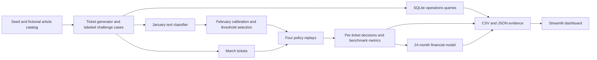

# Architecture and reproduction

| Path | Responsibility |
|---|---|
| supportlab/catalog.py | Eight versioned intent records and approved response text |
| supportlab/data.py | Fixed-seed generator and independent challenge labels |
| sql/operations.sql | Grouped ticket performance and labor cost |
| supportlab/operations.py | SQLite adapter, percentile and independent Python reconciliation |
| supportlab/triage.py | Offline prediction, bin calibration, protective checks, policy replay and metrics |
| supportlab/finance.py | Payback, ROI, break-even, monthly flows, and scenario grid |
| supportlab/study.py | Pipeline, evidence exports, and assumptions loader |
| config/assumptions.json | Seed, deployment cost assumptions, and replay parameters |
| app.py | Four dashboard tabs with filters, stress cases and finance controls |
| tests/ | Financial arithmetic, split isolation, SQL boundaries, policy fallbacks, replay counts, and Streamlit interactions |

The core pipeline uses Python 3.12 and in-memory SQLite. It writes evidence relative to the repository by default. Use `python -m supportlab.study --output replay` to compare a second run without overwriting the packaged files. The dashboard reads the packaged evidence and recomputes finance when assumptions change. If editing the scenario configuration, regenerate the evidence before launching.

## Future GenAI integration

Replace the article proposer with a locally hosted model or a mockable service that returns an approved article ID and optional draft. Validate structured output, check grounding against a versioned article and run the protective rules in application code. Refit confidence calibration for the replacement model on independent labeled examples. Keep send permissions, trusted identity, and specialist routing outside the model service.

The prototype never performs a side effect in a support system. In a pilot, an authenticated approval event should carry ticket version, actor, approved response, policy version and an idempotency key. Reject stale approvals, keep one authoritative case record, and log metadata to a restricted audit trail. Timeouts, invalid response schemas and unavailable articles should return the original ticket to manual handling with its deadline intact.

Streamlit widget behavior is tested through its documented [AppTest interface](https://docs.streamlit.io/develop/api-reference/app-testing/st.testing.v1.apptest).

