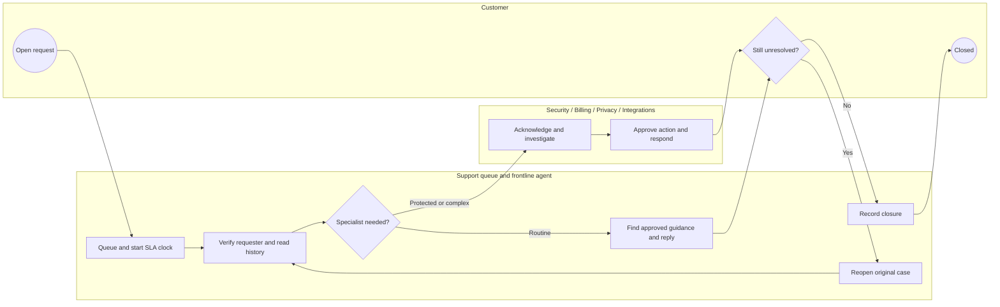
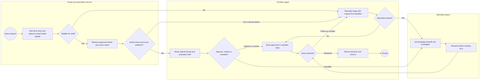

# Business requirements and operating process

## Scope and stakeholders

RelayDesk receives support requests through its authenticated portal. The initial pilot covers English-language guidance for exporting a saved report and pausing a report schedule. The broader replay also covers downloading an invoice receipt and resending a pending invite. Those two workflows require separate scope approval before a live pilot. Drafts describe product steps. Agents remain responsible for verification, context, edits, sending, routing, and closure. Payment adjustments, account recovery, privacy review, outages, and connector diagnosis stay in specialist workflows. The simulation has zero production integrations.

| Stakeholder | Interview question | Decision or evidence needed |
|---|---|---|
| Support operations lead | Which repetitive requests arrive with enough context to answer in one touch? | Eligibility list, queue baseline, staffing plan |
| Frontline agents and QA | When does a plausible draft hide a second request or a failed prior attempt? | Label examples, review checklist, effort measurement |
| Billing lead | Who can verify account entitlement and approve credits? | Route owner and permissions by action |
| Security on-call | Which signals justify immediate incident routing, and who acknowledges the handoff? | Incident triggers, timer, escalation contact |
| Privacy lead | What ticket content may enter a draft service and what must stay in the restricted case system? | Data handling, retention, and review scope |
| Knowledge owner | Which approved article is current for each plan and locale? | Versioned catalog, review cadence, withdrawal path |
| Finance partner | Which overtime, contractor hours, or forecast hiring can be avoided if capacity is recovered? | Realization assumption and measured cost baseline |
| Product support PM | What effect on reopened cases and SLA would justify expansion? | Pilot guardrails, metric definitions, comparison design |

## Requirements and acceptance

| ID | Requirement | Acceptance evidence |
|---|---|---|
| BR-01 | Quantify the manual baseline by workload, risk, plan, and region. | SQL counts, SLA, resolution and labor totals reconcile with ticket-level Python calculations. |
| BR-02 | Give agents an approved draft only when verification, scope, intake signals, and confidence meet policy. | Unverified, repeated, declared mixed, signaled risk, unknown or low-confidence inputs fall back to humans. |
| BR-03 | Require explicit human approval for every AI-assisted reply. | Every AI assist event is review or manual in replay. In a pilot, the send endpoint requires an agent identity and confirmation. |
| BR-04 | Route protected work to a named owner and retain the original SLA clock. | In production design, create a restricted handoff with ticket ID, reason, current SLA deadline and acknowledgement status. Escalate overdue acknowledgement to the duty lead. |
| BR-05 | Trace decisions and edits without copying private data into analytics logs. | Retain ticket reference, policy and KB versions, confidence, rule result, chosen route, reviewer action and timestamps. Pilot access and retention require Privacy and Security approval. |
| BR-06 | Compare quality, safety, latency, and costs on the same labeled cases. | Export individual decisions, grouped metrics, synthetic economics, and stress case outcomes. |
| BR-07 | Maintain fallback under system failure or knowledge withdrawal. | Pilot switches to manual queue on timeout, missing approvals, revoked articles, or dependency failure. Test fallback under load and confirm no duplicate send. |
| BR-08 | Provide a reproducible business case and interactive analysis. | A fresh run regenerates CSV and JSON evidence, and dashboard filter and scenario tests pass. |

BR-04, BR-05 and the production elements of BR-03 and BR-07 are rollout acceptance criteria. Their production integrations are outside this portfolio prototype.

## As-is process

The swimlanes show who owns each step. Diamonds represent exclusive decisions. Each routed ticket retains its original first-reply SLA.

## To-be process for the pilot

## Agent review policy

1. Verify requester and permissions from the account system. Customer claims about identity or entitlement do not override the trusted record.
2. Read the whole thread for repeat contacts, multiple intents, sensitive data, payment adjustments, and suspicious access. Review these signals even when the draft appears correct.
3. Check that article, plan, locale, and instructions match the request. Remove private details from the reply and avoid unsupported promises.
4. Send, edit and send, discard to manual handling, or route to the named specialist. Never perform account recovery, financial adjustments, or deletion from the draft interface.
5. Record a reason on overrides. Preserve the original ticket and SLA clock. Surface unacknowledged handoffs in the duty lead queue.
6. On unsafe sends, an unavailable article catalog, or inability to require approval, disable drafting and use the existing manual workflow. Queue owners handle incident review and re-enablement.

| Signal | Owner | Handling |
|---|---|---|
| Unknown identity or entitlement | Frontline lead | Verify through account system before providing account-specific help |
| Security concern or suspected takeover | Security on-call | Use the restricted incident queue and notify the duty lead |
| Refund or disputed charge | Billing operations | Review entitlement before approving any adjustment |
| Personal data access or erasure | Privacy operations | Verify identity, scope, and retention restrictions |
| Persistent integration issue | Integrations | Collect connector and last successful sync metadata using approved fields |
| Repeat, conflicting signals, low confidence, or unavailable model | Frontline lead | Review manually and route onward if protected |

